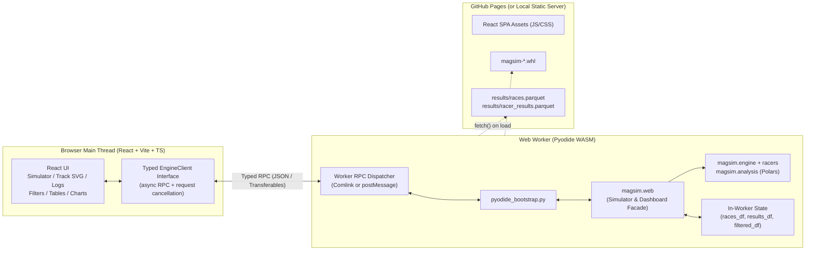

# React + Pyodide Frontend Architecture & Migration Plan

This document captures the feasibility analysis, technical hurdles, architecture decisions, and milestone plan for replacing the current Marimo WASM notebook ([`frontend/magical_athlete_analysis.py`](../frontend/magical_athlete_analysis.py)) with a React single-page application powered by Pyodide (WASM Python + Polars), still deployed via GitHub Pages.

The refactor is intended to be developed on a separate feature branch while keeping the existing Marimo frontend operational until final cutover.

---

## 1. Current-State Inventory

[`frontend/magical_athlete_analysis.py`](../frontend/magical_athlete_analysis.py) is a 3,786-line, 37-cell Marimo app combining two distinct experiences plus WASM deployment glue:

| Area | Current Implementation | Key Coupling / Pain Points |
| --- | --- | --- |
| **Interactive Race Simulator** | Config panel (seed, `BOARD_DEFINITIONS`, roster table with add/remove/reorder/start positions `0..29`, scripted dice, debug log toggle, base64 `GameConfig.encoded` share & load). Runs `GameScenario` synchronously up to 1,000 snapshots via `SnapshotRecorder` + `MetricsAggregator`. | State lives in Marimo `mo.state` cells; clicking a row in raw tables mutates shared state to load a race. |
| **Track Visualization** | `render_game_track` builds a 31-tile stadium SVG via ~350 lines of Python f-strings (`VictoryPointTile`, `TripTile`, `MoveDeltaTile`, `RacerPalette` colors, multi-racer offsets, tripped `X`, tooltips, center active racer + die roll). | Hard to maintain, animate between steps, or extend for Second Wind board features (twists, corners/turns, dynamic modifiers, eliminated racers, pieces). |
| **Log Viewer** | `rich.Console(record=True)` + `RichHandler` + `GameLogHighlighter` + `RichMarkupFormatter` → `export_html(inline_styles=True)` + `mo.iframe` JS injection hack to auto-scroll the parent DOM to `▲ CURRENT STEP`. | Fragile DOM hack; logs are static HTML (cannot click a log line to jump to a step or filter by racer without re-running). |
| **Data Loading** | Loads `races.parquet` (3.7 MB) + `racer_results.parquet` (3.6 MB) from [`docs/results/`](./results/). URL/WASM mode uses `urllib.request` + `pyarrow.parquet.read_table` → `pl.from_arrow` + `.cast(pl.List(pl.Utf8))` on `racer_names`. Local mode uses `pl.read_parquet` with GitHub raw ETag cache in `~/.magsim/results_cache`. | Pulls `pyarrow` + `numpy` solely to decode Parquet in WASM; local vs WASM paths diverge. |
| **Filter Pipeline** | Racer pool multiselect + "Select automatic racers" button (excludes `BooleanInteractive` / `SelectionInteractive`), racer count, board, advanced combo filters (`Must Include All` / `Must Exclude Combination`), explicit `Run Analysis` button + stale-filter banner. | `cell_general_filters_ui` is duplicated in the notebook; filter state management in Marimo cells is brittle. |
| **Polars Analytics (`_calculate_all_data`)** | ~500 lines of Polars expressions: Dicemonger/Magician dice-luck attribution, Inchworm skip-turn cost correction, normalized ability movement (`+Self`, `-Self`, `+Others`, `-Others`), consistency ($\mu \pm \sigma$), win/2nd rates, correlations (dice sensitivity, trigger dependency, start-pos bias, midgame bias), matchup matrix (VP shift & `% shift`), environment adaptability (board × player count), and 20-bin quantile-trimmed distributions. | Trapped inside notebook cells: untestable with `pytest`, un-linted/un-typed alongside [`src/magsim/analysis/`](../src/magsim/analysis/), and duplicates future work tracked in [`docs/analysis_ideas.md`](./analysis_ideas.md). |
| **Tables & Charts** | 2 raw interactive tables (`Races (Matrix View)`, `Racer Results` with row click → load simulator), 5 summary tables (`Overview`, `Movement`, `VP Analysis`, `Abilities`, `Dynamics`), 2 Altair heatmaps (`Interactions`, `Environments` with `% shift` / absolute toggle), and 6 Altair chart tabs (`Consistency`, `Ability Speed`, `Momentum`, `Excitement`, `Engine`, `Global` with rank-scale toggle & chart height slider). | Altair/Vega specs are Python-built inside the WASM runtime; no cross-chart hover/selection; limited layout & responsive control. |
| **Packaging & Deploy** | [`scripts/release_prep.py`](../scripts/release_prep.py) pins `MAGSIM_VERSION` in the notebook so Pyodide installs `magsim==<ver>` from PyPI, runs `marimo export html-wasm` into `docs/`, and copies Parquet files to `docs/results/`. [`magsim gui`](../src/magsim/cli/commands/gui.py) launches Marimo locally via `uvx`. | Frontend cannot be deployed or previewed with unreleased engine changes without publishing `magsim` to PyPI first. |

---

## 2. Feasibility Assessment

**Verdict: High feasibility — core runtime risk is already proven.**

Marimo's `html-wasm` export already runs Pyodide + `magsim` + `polars` + `pyarrow` in the browser on GitHub Pages today. Replacing Marimo with React does not introduce an unproven Python-in-browser execution model; it replaces the **UI layer, reactivity model, and visualization renderer** while keeping the Python simulation and Polars analytics engine.

What makes `magsim` especially well suited for Pyodide:

- `magsim.core`, `magsim.engine` (except `rich` in `logging.py`), `magsim.racers`, `magsim.ai`, and `magsim.data` are **pure Python** (stdlib only).
- `magsim.simulation.config` (`GameConfig.encoded` / `from_encoded`) and `magsim.simulation.db.models` (`Race`, `RacerResult`) depend only on `msgspec`, which ships a Pyodide wheel.
- `magsim.simulation.telemetry` (`SnapshotRecorder`, `StepSnapshot`, `MetricsAggregator`) already exposes the exact per-step simulation data needed by a React track & log viewer.
- `duckdb` (`magsim.simulation.db.manager`), `cappa` (CLI), and `tqdm` (batch progress bars) are **never imported** by the interactive simulator or analytics dashboard.

---

## 3. Hurdles & Mitigations

| ID | Hurdle | Why It Matters | Concrete Mitigation |
| --- | --- | --- | --- |
| **H1** | **Bloated WASM dependencies & cold start** | [`pyproject.toml`](../pyproject.toml) lists `duckdb-engine`, `cappa`, and `tqdm` in core `dependencies`. `micropip.install("magsim")` currently drags `duckdb` + `sqlalchemy` + `cappa` + `tqdm` into the browser even though the frontend never uses them. | Split optional extras in `pyproject.toml` (e.g., `[cli]`, `[db]`) **or** install the bundled `magsim` `.whl` in Pyodide with `deps=False` and explicitly install only the WASM manifest (`polars`, `msgspec`, plus `pyarrow`/`rich` only if still required). |
| **H2** | **Strict Python pin (`requires-python = "==3.12.7"`)** | Pyodide pins a specific CPython version per release (e.g. Pyodide `0.27.x` → `3.12.7`; `0.28+` → `3.13.x`). An exact pin blocks upgrading Pyodide (and newer Polars WASM wheels) or fails wheel resolution in `micropip`. | Relax `requires-python` to `>=3.12,<3.14` (or explicitly align the pinned Pyodide version in Milestone 0 before updating Python). |
| **H3** | **Polars WASM Parquet & single-threaded execution** | In the current Marimo app, native Polars Parquet reading failed in WASM, requiring `pyarrow.parquet.read_table` → `pl.from_arrow` (~20+ MB extra wheel). GitHub Pages also does not send COOP/COEP headers for `SharedArrayBuffer` / WASM threads. | Benchmark modern Pyodide + `polars` native `pl.read_parquet` in Milestone 0. If native Parquet still fails, keep `pyarrow` as fallback or evaluate shipping Arrow IPC (`.ipc` / Feather) alongside Parquet if `polars.read_ipc` works without `pyarrow`. Single-threaded Polars on ~7 MB of Parquet runs in tens to hundreds of milliseconds. |
| **H4** | **Main-thread UI freezes** | Loading Pyodide, reading Parquet, running Polars aggregations, or stepping a 1,000-snapshot simulation on the main thread freezes scrolling, clicks, and animations. | Run Pyodide exclusively inside a **dedicated Web Worker** behind an async typed RPC bridge (e.g., `comlink` or a small message-ID dispatcher) with monotonic request IDs and granular loading-stage events (`loading pyodide` → `installing wheels` → `loading parquet` → `ready`). |
| **H5** | **Large DataFrame serialization across Worker boundary** | Converting tens of thousands of `races` / `racer_results` rows to JSON on every filter change causes GC spikes and lag. | Keep full Polars DataFrames resident inside the Python worker. Send **small pre-aggregated JSON payloads** (a few KB) for charts and summary tables, and perform **worker-side sort/filter/pagination** for the raw `Races` and `Racer Results` tables (transferring only the visible page, e.g. 50–100 rows). |
| **H6** | **PyPI release coupling** | Today, `release_prep.py` pins `MAGSIM_VERSION` from PyPI, making branch previews and unreleased engine testing painful. | Build the local pure-Python `magsim-*.whl` (`uv build --wheel`) during the frontend build and serve it as a static asset from the same origin (`micropip.install("./wheels/magsim-....whl", deps=False)`). Zero PyPI dependency for dev, branch previews, or GitHub Pages deploys. |
| **H7** | **Python ↔ TypeScript schema drift** | Changing a field name in Python analytics or simulator output could silently break React components. | Define explicit Python DTOs (`msgspec.Struct` or typed `dataclass`es) in one API module and mirror them in TypeScript (`web/src/types/api.ts`), validated by Python contract tests (and optionally JSON Schema → TS generation if the surface grows). |
| **H8** | **Second Wind expansion compatibility** | Active work on [`src/magsim/engine/board.py`](../src/magsim/engine/board.py) adds `first_corner`, `second_turn`, `twists`, `dynamic_modifiers`, `mirror()`, eliminated racers, and pieces (see [`docs/second_wind_analysis.md`](./second_wind_analysis.md)). | Model the simulator snapshot DTO around tile metadata (`special_tiles`, `modifiers`, `corners`, `turn_markers`), racer state (`position`, `tripped`, `eliminated`, `vp`, `finished`, `pieces`), and active twists from day one so Second Wind slots into the React track without another rewrite. |

---

## 4. Advantages Over Marimo App Mode

1. **First-class interactive UI & layout**: Full control over responsive layouts, split panes, dark/light themes, keyboard shortcuts (e.g., `←`/`→` for step playback, `Space` for play/pause), URL query-parameter state sharing (`?config=<base64>` and filter presets), and smooth SVG transitions on the racetrack.
2. **Real interactive race logs**: Replacing `rich` HTML export + `mo.iframe` JS auto-scroll with structured log events unlocks native `scrollIntoView`, click-a-log-line-to-jump-to-step, instant client-side filtering by racer or debug level (without re-running the simulation), and consistent `RacerPalette` badges.
3. **Clean architectural separation**: Extracting `_calculate_all_data` and simulator orchestration out of a 3,786-line notebook into typed Python modules enables `pytest`, `ruff`, and `pyrefly` coverage and lets [`docs/analysis_ideas.md`](./analysis_ideas.md) metrics live in one shared place.
4. **Faster cold start & leaner payload**: Dropping the Marimo runtime, `altair`/`vega` Python packages, `duckdb`, `sqlalchemy`, `cappa`, and `tqdm` from WASM significantly reduces download size and initialization time.
5. **Cross-component interactivity**: Clicking a racer dot in a quadrant chart can highlight that racer across every chart, heatmap row/column, and table; clicking any row in `Races` or `Racer Results` smoothly switches to the Simulator tab preloaded with that exact seed, board, and roster.
6. **Superior frontend DX**: Vite HMR updates React components in milliseconds without restarting Python or reloading Parquet datasets.

---

## 5. Architecture Decisions

### ADR-1: Python Code Placement — Inside `magsim` vs. Separate BFF

| Option | Pros | Cons |
| --- | --- | --- |
| **A. Package inside `magsim`** (extend [`src/magsim/analysis/`](../src/magsim/analysis/) + thin `src/magsim/web/` or `src/magsim/api/` facade) | Single source of truth for analytics metrics (aligns directly with [`docs/analysis_ideas.md`](./analysis_ideas.md)); full `pytest`/`ruff`/`pyrefly` integration; automatically packaged inside the single `magsim` `.whl` loaded by Pyodide; reusable by CLI or a future local HTTP server. | Adds small UI-oriented DTO/facade modules inside `magsim` (must remain decoupled from React specifics and free of browser-only imports). |
| **B. Separate BFF package** (e.g., `web/python/` or `packages/magsim-bff/`) | Strict boundary keeping `magsim` unaware of web DTOs or pagination concerns. | Two Python packages to build/install into Pyodide, separate lint/type/test config, and temptation to duplicate Polars analytics logic outside `magsim.analysis`. |

**Recommendation: Option A (hybrid-clean split inside `magsim`).**
- Put pure, reusable Polars metric computations into [`src/magsim/analysis/`](../src/magsim/analysis/) (zero UI assumptions; testable with `pytest`).
- Put thin, JSON-serializable request/response facades (filter queries, paginated table queries, simulator execution → structured snapshots & logs) into `src/magsim/web/` (pure Python + Polars + `msgspec`, no `js`/`pyodide` imports).
- Keep the tiny browser-specific bootstrap glue (~50 lines that receives JS calls / bytes and invokes `magsim.web`) inside the frontend folder (`web/src/worker/pyodide_bootstrap.py`).

---

### ADR-2: Runtime Bridge & Data Flow



Key design rules for the bridge:
- **Never block the main thread**: All Pyodide initialization, Parquet decoding, Polars queries, and `GameScenario` runs happen inside the Web Worker.
- **Transport-agnostic `EngineClient`**: React components only talk to an async TypeScript interface (`init()`, `loadDataset()`, `runSimulation(config)`, `runAnalysis(filters)`, `queryRawTable(table, page, sort, search)`). This isolates Pyodide details and keeps a future local HTTP backend drop-in compatible (see ADR-5).
- **Transfer sizing**:
  - Aggregated charts, heatmaps, and summary tables → plain JSON (~10–150 KB).
  - Raw `races` and `racer_results` tables → worker-side filter/sort/paginate returning 50–100 rows per page.
  - Simulator run → single payload containing board geometry/tiles, initial roster + palettes, `StepSnapshot[]` (capped at 1,000), structured log events, and final metrics.

---

### ADR-3: Frontend Stack, Tables, Charts & Track

Building on existing familiarity with **Vite + React + Tailwind CSS v4** (as used in your existing React dashboard), adding **TypeScript** is strongly recommended so the Python ↔ JS DTO contract is type-checked across every chart, table, and simulator component.

- **Core UI**: Vite + React 19 (or 18) + TypeScript + Tailwind CSS v4 + headless primitives (e.g., Radix UI / shadcn/ui or lightweight Tailwind components for tabs, multiselect comboboxes, sliders, modals).
- **Interactive Tables**: **TanStack Table (`@tanstack/react-table`)**
  - Handles sorting, column filtering, pinned columns, custom cell formatting (color-coded cells, badges, `RacerPalette` dots), row selection/click-to-simulate, and both client-side mode (5 summary tables) and manual/worker-paginated mode (raw `Races` and `Racer Results` tables).
- **Interactive Charts Comparison**:

| Library | Fit for Current Chart Inventory | Pros | Cons |
| --- | --- | --- | --- |
| **Apache ECharts** (`echarts`) | **Excellent** — native 2D scatter (per-point colors, direct labels, `markLine`/`markArea` quadrants, custom HTML tooltips, zoom), diverging stacked bars, $N \times N$ heatmaps with visualMap & cell labels, multi-grid faceted histograms. | Canvas rendering stays smooth with hundreds of heatmap cells & tooltips; rich built-in interactivity (hover emphasize, click events for cross-filtering, legend toggle, responsive resize). | Imperative option objects (mitigated with a ~40-line reusable `<EChart option={...} onEvents={...} />` wrapper); larger JS bundle unless tree-shaken (`echarts/core`). |
| **Vega-Lite (`vega-embed`)** | **Excellent** — exact grammar already used by Altair in the Marimo notebook. | Lowest translation cost from existing Altair specs (rank-scale quadrants, heatmaps, facets port almost 1:1); clean declarative JSON specs. | Less natural React integration for custom rich HTML tooltips, cross-chart state, and dark/light theming; heavier bundle (`vega` + `vega-lite` + `vega-embed`). |
| **Recharts + Custom SVG** | **Partial** — fine for simple scatter/bars, lacks native heatmaps, clean diverging stacks, and faceted small-multiples. | Familiar React JSX API; already used in your other React project. | Requires custom SVG/Canvas implementations for both heatmaps and faceted histograms, and struggles with dense labeled scatter plots (label placement & tooltips). |

**Recommendation:**
- **Charts**: **Apache ECharts** (tree-shaken via `echarts/core` with a thin React wrapper) for the best native web-app interactivity (custom per-dot colors, hover info, click-to-highlight racer across charts, heatmaps, quadrants, and faceted histograms). *Alternative:* choose **Vega-Lite** if minimizing chart-porting effort from Altair outweighs richer React interactivity.
- **Tables**: **TanStack Table**.
- **Race Track**: **Custom declarative React SVG** (`<RaceTrack />`, `<TrackTile />`, `<RacerToken />`, `<CenterDie />`), using `RacerPalette` data directly from Python. Declarative SVG makes animated token movement, hover tooltips, zoom/pan, and Second Wind board additions straightforward.

---

### ADR-4: Structured Race Logs vs. `rich` HTML Export

| Option | Pros | Cons |
| --- | --- | --- |
| **A. Structured log events from Python** (recommended) | Eliminates `rich` HTML export and the `mo.iframe` JS scroll hack; native `scrollIntoView`; click any log entry to jump playback to that step; instant client-side filter by racer or debug level; consistent `RacerPalette` styling & dark mode; removes `rich` from required WASM deps (if `logging.py` is lazily imported or decoupled). | Small adapter needed in `magsim` telemetry/logging to emit typed log records alongside (or instead of) formatted strings. |
| **B. Keep `rich.Console.export_html` in Pyodide** | Zero change to `GameLogHighlighter` / `RichMarkupFormatter` during initial port. | Preserves static HTML blobs, harder theming, no click-to-jump without brittle DOM parsing, keeps `rich` in WASM. |

**Recommendation: Option A.** Capture structured log records (`index`, `step_index`, `round`, `turn`, `level`, `racer_id`, `category`, `message`, optional `spans` for highlighted tokens) inside `magsim.web.simulator`. If helpful for velocity during Milestone 3, plain formatted lines + `step_index` can ship first and rich inline token spans can be layered in cleanly.

---

### ADR-5: Local Development & `magsim gui` Workflow (Comparison)

| Option | How It Works | Pros | Cons |
| --- | --- | --- | --- |
| **A. Pyodide Everywhere** | On GitHub Pages, React loads Parquet from `./results/`. Locally, Vite dev server (during development) or a lightweight `magsim gui` Python static HTTP server serves the built SPA + mounts a local `results/` directory (plus an optional drag-and-drop / file picker in the UI for arbitrary `.parquet` files). | **Single runtime everywhere** — zero behavioral drift between local and GitHub Pages; zero FastAPI/uvicorn dependencies; `magsim gui` stays tiny and stdlib-only (`http.server`). | Local Polars runs inside single-threaded WASM (~2–5× slower than native Polars on very large local datasets, e.g., >50 MB Parquet). |
| **B. Dual Transport (Pyodide + Optional Local HTTP API)** | `EngineClient` has two implementations: `PyodideEngine` (default / GitHub Pages) and `HttpEngine` (local dev / `magsim gui --native`), talking to a thin FastAPI/Starlette wrapper over the exact same `magsim.web` functions. | Full multi-threaded native Polars speed on huge local simulation runs; instant local folder browsing & ETag caching without browser memory limits. | Extra local server dependency (`starlette`/`uvicorn` in `[gui]` extra), two transports to keep tested, slight risk of Pyodide-only bugs escaping local testing. |

**Recommendation:** Start with **Option A (Pyodide Everywhere)** for simplicity and parity, while keeping the TypeScript `EngineClient` interface strictly async and transport-agnostic. If local simulation datasets later grow too large for browser WASM memory/speed, **Option B** can be added cleanly as a second `EngineClient` adapter over the exact same `magsim.web` Python functions.

---

### ADR-6: GitHub Pages Deployment Strategy (Comparison)

| Option | How It Works | Pros | Cons |
| --- | --- | --- | --- |
| **A. GitHub Actions (`actions/deploy-pages`)** | A workflow on `main` (and manual `workflow_dispatch`) builds `magsim` wheel (`uv build --wheel`), builds the Vite SPA (`npm ci && npm run build`), copies the wheel + `results/*.parquet` into `dist/`, and deploys directly to GitHub Pages. | **Clean git history** (no committed minified JS/CSS/WASM/wheel binaries); decouples code PRs from release scripts; easy to run build checks in PR CI; eliminates `scripts/publish_frontend.sh` & Marimo export hacks. | Requires enabling "GitHub Actions" as the Pages source in repo settings and maintaining one ~40-line `.github/workflows/deploy-pages.yml`; Parquet dataset still needs a storage home (either committed in `docs/results/` / `data/` or fetched from GitHub Release assets). |
| **B. Committed `docs/` Folder (Current Setup)** | Local build script (`poe release-prep` / `scripts/release_prep.py`) builds wheel + Vite SPA into `docs/` and commits the built output alongside `docs/results/*.parquet`. | Zero GitHub Actions or repo settings changes; works identically to today's `poe release` flow. | Bloats git history with hashed JS/CSS chunks and `.whl` binaries on every UI tweak; merge conflicts on built files across branches. |

**Recommendation:** **Option A (GitHub Actions)** for the React app build + Pages deploy, keeping `docs/results/*.parquet` (or a dedicated `data/results/` or GitHub Release artifact) as the data input. During development on the feature branch, Vite + local static preview works without touching live `docs/` Pages until cutover.

---

### ADR-7: `magsim` Packaging & Dependency Split

Current [`pyproject.toml`](../pyproject.toml) installs all runtime dependencies unconditionally:
```toml
dependencies = [
    "rich>=13.7.1",
    "cappa>=0.31.0",
    "duckdb-engine>=0.17.0",
    "msgspec>=0.18.6",
    "tqdm>=4.67.1",
    "polars>=1.24.0",
]
```

Two complementary improvements:
1. **In Pyodide bootstrap (immediate, zero breaking change for CLI users):** Install the bundled `magsim-*.whl` with `micropip.install(wheel_url, deps=False)` and explicitly load only the WASM-required packages (`polars`, `msgspec`, plus `pyarrow`/`rich` only if still needed after M0).
2. **Optional future cleanup in `pyproject.toml`:** Relax `requires-python` (e.g. `>=3.12,<3.14`) and evaluate moving `duckdb-engine`, `cappa`, `tqdm` behind optional extras if external library consumers want a slim `pip install magsim` (note: keep default `magsim` CLI install working seamlessly via `uvx magsim` / `pip install magsim` if CLI is the primary distribution channel — `deps=False` in Pyodide already solves the WASM bloat without breaking `uvx magsim`!).

---

## 6. Proposed Directory Layout

During the migration branch, the new frontend can live cleanly beside the existing `frontend/` Marimo notebook until Milestone 6 cutover:

```text
magsim/
├── src/magsim/
│   ├── analysis/                 # Reusable Polars metrics & aggregations (shared with CLI & web)
│   │   ├── aggregation.py        # Existing batch aggregation
│   │   ├── filters.py            # Filter specs, automatic-racer detection, combo include/exclude
│   │   ├── metrics.py            # Extracted _calculate_all_data (overview, speed, VP, abilities, dynamics)
│   │   └── interactions.py       # Matchup matrix & environment adaptability
│   ├── simulation/               # Existing scenario, config, telemetry
│   └── web/                      # Thin, browser-agnostic facade (JSON-serializable DTOs)
│       ├── schemas.py            # msgspec.Struct / dataclass request & response contracts
│       ├── simulator_api.py      # Run GameScenario → board, snapshots, structured logs, metrics
│       └── dashboard_api.py      # Dataset state, run_analysis(), paginated raw table queries
├── web/                          # New React + TypeScript + Vite + Tailwind v4 app
│   ├── package.json
│   ├── vite.config.ts
│   ├── public/
│   │   ├── wheels/               # Built magsim-*.whl (copied at build/dev time, gitignored)
│   │   └── results/              # Symlinked/copied Parquet files in dev (gitignored)
│   └── src/
│       ├── types/api.ts          # TypeScript DTOs matching magsim.web.schemas
│       ├── engine/               # EngineClient interface + PyodideEngine + worker.ts + pyodide_bootstrap.py
│       ├── features/
│       │   ├── simulator/        # ConfigPanel, RosterEditor, RaceTrackSVG, LogViewer, PlaybackBar
│       │   ├── filters/          # FilterSidebar, ComboFilterEditor, StaleBanner
│       │   ├── tables/           # RawRacesTable, RawResultsTable, SummaryTables (TanStack Table)
│       │   └── charts/           # EChart wrapper, QuadrantChart, AbilitySpeedChart, GlobalCharts, Heatmaps
│       └── App.tsx
├── frontend/                     # Legacy Marimo notebook (untouched until M6 cutover)
└── docs/
    ├── react_frontend_architecture.md
    └── results/                  # races.parquet, racer_results.parquet
```

---

## 7. Phased Migration Milestones

All work happens on a dedicated branch (e.g., `feat/react-pyodide-frontend`), leaving `main` and the live Marimo GitHub Pages site untouched until Milestone 6.

| Milestone | Scope | Key Deliverables | Exit Criteria / Verification |
| --- | --- | --- | --- |
| **M0 — Pyodide + Polars Spike** | Risk retirement & benchmarks before full build-out. | Minimal Vite + Web Worker prototype that boots Pyodide, installs local `magsim-*.whl` (`deps=False`), loads `races.parquet` & `racer_results.parquet`, runs a Polars aggregation and a 1-race `GameScenario`. | Measured cold-start time & download size; verified whether `polars` reads Parquet natively or still requires `pyarrow`; confirmed `requires-python` & Pyodide version pairing; **Go/No-Go sign-off**. |
| **M1 — Extract Python Backend APIs** | Refactor Python logic out of [`frontend/magical_athlete_analysis.py`](../frontend/magical_athlete_analysis.py) into `src/magsim/analysis/` and `src/magsim/web/`. | Typed DTOs (`schemas.py`), extracted `_calculate_all_data` metrics/heatmaps/filters, worker-side raw table pagination/sorting, and `simulator_api.py` (with structured log events & Second Wind–ready board/snapshot schema). | `pytest` parity tests comparing new `magsim.analysis` / `magsim.web` outputs against reference outputs from the current notebook on `docs/results/*.parquet`; `ruff` and `pyrefly` pass cleanly. |
| **M2 — React App Shell & Worker Bridge** | Build frontend foundation and dataset lifecycle. | Vite + React + TS + Tailwind v4 scaffold in `web/`, Web Worker + `EngineClient`, phased loading/progress screen, Parquet loader (default URL + optional local file upload), app navigation (Simulator / Analytics) & URL state helpers. | App boots cleanly in dev and production `vite preview`, loads both Parquet files in worker without UI jank, handles worker errors & retries gracefully. |
| **M3 — Interactive Race Simulator** | Full simulator feature parity + improved UX. | Config panel (seed, board, scripted dice, debug toggle, roster add/remove/reorder/start pos), base64 `GameConfig` share/load + `?config=` URL param, declarative React SVG racetrack (31 tiles, palettes, offsets, tripped state, center die, tooltips, playback controls + keyboard shortcuts), structured interactive log viewer (auto-scroll, click-to-jump, racer/debug filter). | Visual & functional parity with Marimo simulator; deterministic replay matches encoded configs; smooth playback across 100+ step races. |
| **M4 — Filters & Interactive Tables** | Port data filtering and all tabular views. | Filter sidebar (racer pool + "Automatic Racers", racer count, board, `Must Include All` / `Must Exclude Combination`, stale-filter indicator, `Run Analysis`), TanStack Table for worker-paginated `Races (Matrix View)` & `Racer Results` (with row-click → "Open in Simulator"), and the 5 summary tables (`Overview`, `Movement`, `VP Analysis`, `Abilities`, `Dynamics`). | Sorting, filtering, pagination, and row-click-to-simulator all work without main-thread lag; numeric values match M1 parity fixtures. |
| **M5 — Interactive Charts & Heatmaps** | Port all visualizations with enhanced interactivity. | Reusable `<EChart />` (or Vega-Lite) wrapper; 4 quadrant scatter plots (`Consistency`, `Momentum`, `Excitement`, `Engine`) with rank-scale toggle, custom `RacerPalette` dot colors, dot labels & rich tooltips; `Ability Speed` diverging stacked bar; `Global` grouped facets & mirrored turn/VP histograms; `Interactions` & `Environments` heatmaps with `% shift` / absolute toggle; optional cross-chart racer highlight. | All 6 chart tabs + 2 heatmaps render accurately and resize cleanly across desktop/laptop viewports; hover tooltips and toggles match or exceed Marimo UX. |
| **M6 — Cutover, Deploy & Cleanup** | Replace Marimo on GitHub Pages and clean up legacy tooling. | Finalize chosen GitHub Pages workflow (GH Actions or `docs/`), update `magsim gui` and [`pyproject.toml`](../pyproject.toml) `poe` tasks, run end-to-end parity checklist, remove `frontend/magical_athlete_analysis.py` & `marimo`/`altair` extras, update [`README.md`](../README.md). | Live GitHub Pages deployment serves React + Pyodide app; `magsim gui` works locally; CI passes; legacy Marimo dependencies removed. |

---

## 8. Locked Decisions (Post-M0)

All open decisions from initial planning are now locked based on the M0 Pyodide + Polars benchmark (`v314.0.8`, Python `3.14.2`, Polars `1.33.1`, `msgspec 0.20.0`, 49,562 races / 239,178 racer results):

| Decision | Locked Choice | Rationale / M0 Evidence |
| --- | --- | --- |
| **Pyodide Runtime** | `v314.0.8` (Python `3.14.2`, Polars `1.33.1`, `msgspec 0.20.0`) | `magsim` runs deterministically on Python 3.14.2; `v0.29.5` lacks a Polars wheel. `requires-python` relaxed to `>=3.12,<3.15`. |
| **Dataset Format in WASM** | **Arrow IPC (`zstd`)** for default web datasets (`races.zstd.ipc`, `racer_results.zstd.ipc`, plus the optional `mush_pairs.zstd.ipc`, a ~10 KB table of Mush's power pairs listed in the runtime manifest as `mushPairs`; uploaded datasets have none and fall back to their own Mush rows); optional lazy-loaded `pyarrow` only for user-uploaded `.parquet` files | Native `pl.read_parquet` is absent in Pyodide Polars `1.33.1` (`PyLazyFrame` lacks `new_from_parquet`). Native `pl.read_ipc` (`zstd`, 9.23 MB) parses both tables in **699 ms** vs **1,713 ms** for `pyarrow.parquet`, while avoiding **+17.53 MB** of `pyarrow`/`pandas`/`numpy` wheels (**~15.9 MB net savings**). |
| **Python Packaging & Wheel Install** | Direct `pyodide.loadPackage(wheelUrl)` (no `micropip`) + `rich` lazy-imported in `magsim.engine.logging` | Installs `magsim-*.whl` (0.17 MB) in **16 ms** without resolving CLI/DB dependencies (`duckdb-engine`, `cappa`, `tqdm`, `rich`). |
| **Boot Parallelization & Caching** | Parallel `fetch()` of IPC data + wheels from $t=0$ alongside `loadPyodide()`, plus Cache Storage for the 18.24 MB `polars` wheel | Chromium's HTTP cache skips the single 18.24 MB `polars` wheel; Cache Storage + parallel fetches target **~2.0–2.5 s** warm repeat load and **~3.5–4.5 s** cold load at 100 Mbps. |
| **Charting Library** | **Apache ECharts** (tree-shaken `echarts/core`) | Native scatter quadrants, diverging bars, heatmaps, and faceted histograms with rich tooltips and cross-chart racer highlighting. |
| **Local `magsim gui` Mode** | **Pyodide everywhere** behind transport-agnostic `EngineClient` | Single runtime everywhere; `magsim gui` stays lightweight stdlib HTTP server; HTTP backend remains drop-in if ever needed later. |
| **GitHub Pages Deployment** | **GitHub Actions** (`actions/deploy-pages`) | Keeps git history clean of built JS/CSS/wheels; builds `magsim` wheel, `.zstd.ipc` exports, and Vite SPA in CI. |
| **Log Formatting** | **Structured JSON events** from `magsim.web.simulator_api` | Eliminates `rich` HTML export and iframe scroll hacks; unlocks click-to-jump, client-side filtering, and dark/light theming. |
